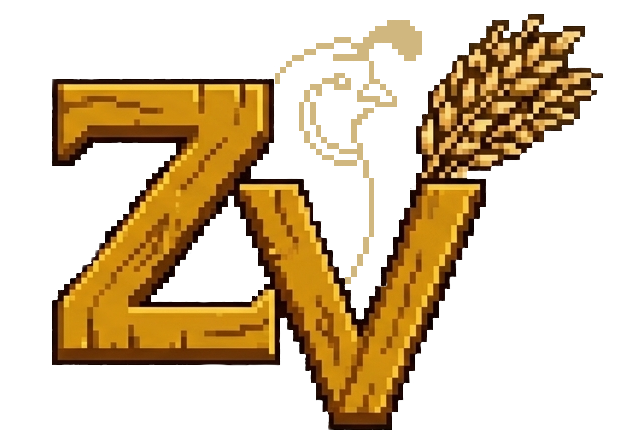
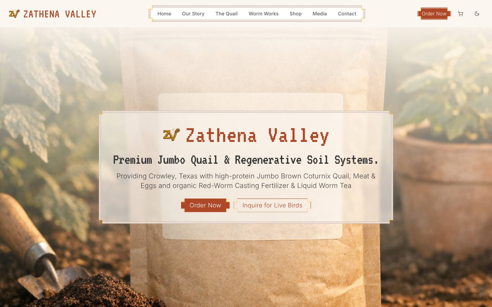
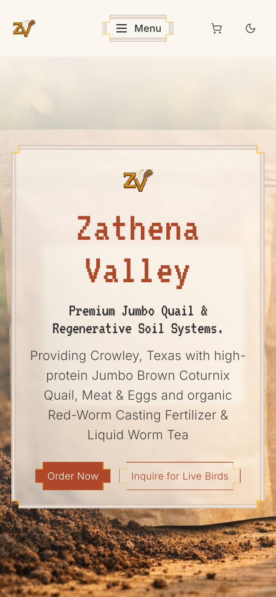

  

<h1 align="center"><a href="https://farm.zathenaventures.xyz">Zathena Valley</a></h1>

  Zathena Valley is a homestead farm in Crowley, Texas, run by ZADAN and partners. It raises quail, works the soil with worms and grows sprouts, and it opens the land to campers and community. This site is where you buy the goods direct, reserve the next harvest and read how the farm started.

  <strong>Live site:</strong> <a href="https://farm.zathenaventures.xyz">farm.zathenaventures.xyz</a>

  <a href="#what-it-is">What it is</a> · <a href="#features">Features</a> · <a href="#book-or-get-in-touch">Get in touch</a> · <a href="#connected-brands">Connected brands</a>

  
  
  
  
  
  

<table>
  <tr>
    <td align="center" valign="top"> Desktop: the farm hub home page.</td>
    <td align="center" valign="top"> Mobile: the same page on a phone.</td>
  </tr>
</table>

## What it is

Zathena Valley is a working farm, not a digital business. Quail are the flagship, and the worm beds feed a regenerative approach to the soil. It stands on its own: the farm is not part of the shared accounts or shared profiles that the Zathena Ventures digital brands use. Zathena Ventures built and hosts its website, and that is the connection.

The site does three jobs. It sells farm goods direct, it brings people out to the land, and it tells the story of the homestead and where it is heading next.

## Features

### The farm
- **[The Quail](https://farm.zathenaventures.xyz/the-quail)**: quail and quail eggs, the homestead's flagship.
- **[Worm Works](https://farm.zathenaventures.xyz/worm-works)**: vermiculture and worm castings.
- **Sprouts**: microgreens and sprouts.
- **[Our Story](https://farm.zathenaventures.xyz/our-story)**: how the homestead started, with a roadmap of where it is going.

### Shop and orders
- **[Shop](https://farm.zathenaventures.xyz/shop)**: the full catalog, with a detail page, options and photos for each product.
- **Slide-out cart**: add goods without leaving the page you are on.
- **Pre-orders**: reserve goods ahead of a harvest.
- **Support the farm**: give directly if you want to help the homestead grow.

### On the land
- **Campsites**: stay on the homestead, booked right from the site.
- **Community**: the farm's community program.
- **Location map**: property details and directions.

### Media and news
- **[Media](https://farm.zathenaventures.xyz/media)**: video and press, a filterable photo gallery and a first-person feed from the homestead.
- **Testimonials**: what visitors and customers have said.
- **Newsletter**: sign up for the updates you care about.

### Site-wide
- **Quick contact**: a floating button for questions from any page.
- **[FAQs](https://farm.zathenaventures.xyz/faqs)** and an [accessibility statement](https://farm.zathenaventures.xyz/accessibility-statement).

## Book or get in touch

Questions about orders, campsites or visiting? Use the [contact page](https://farm.zathenaventures.xyz/contact), or start at the [shop](https://farm.zathenaventures.xyz/shop).

## Connected brands

- **[ZADAN](https://zadan.xyz)**: runs the homestead with partners.
- **[Zathena Ventures](https://zathenaventures.xyz)**: built and hosts this website ([repo](https://github.com/ZATHENA-VENTURES/ZathenaVentures-Public)). The farm itself is a separate business.

## License

© 2026 Zathena Valley. All rights reserved.

## Credits & Contact

- **Live site:** [farm.zathenaventures.xyz](https://farm.zathenaventures.xyz)
- **Contact:** [farm.zathenaventures.xyz/contact](https://farm.zathenaventures.xyz/contact)
- **Built and hosted by:** [Zathena Ventures](https://zathenaventures.xyz)

> This is the public showcase of a private repository. It presents the project, its features and its live site, and leaves out source code and deployment details.
